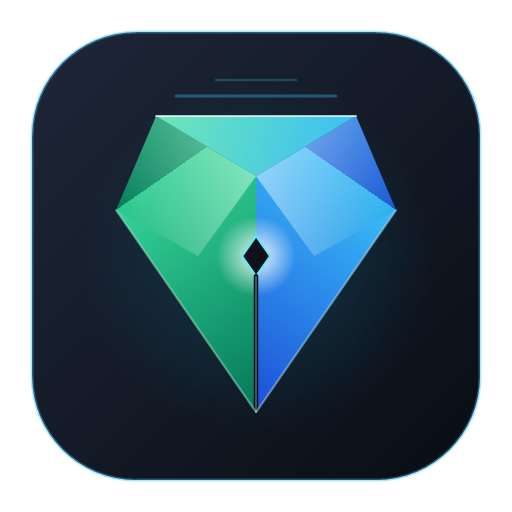
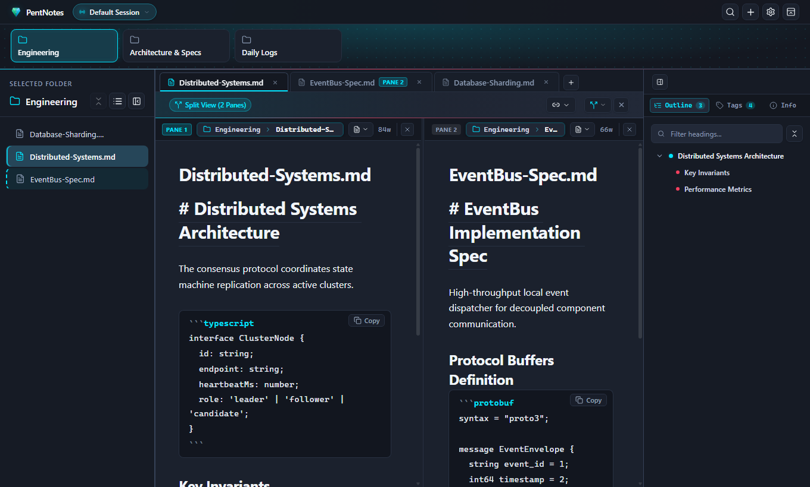
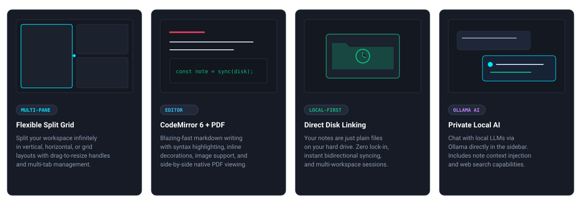
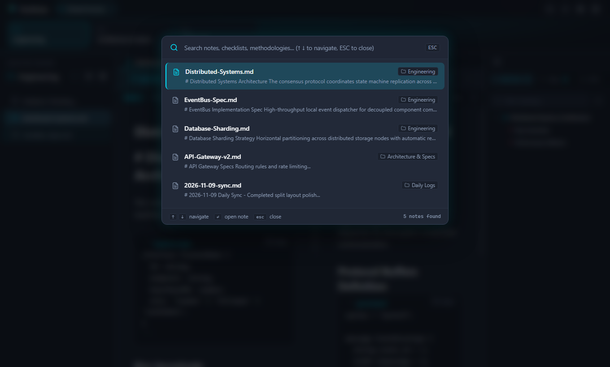
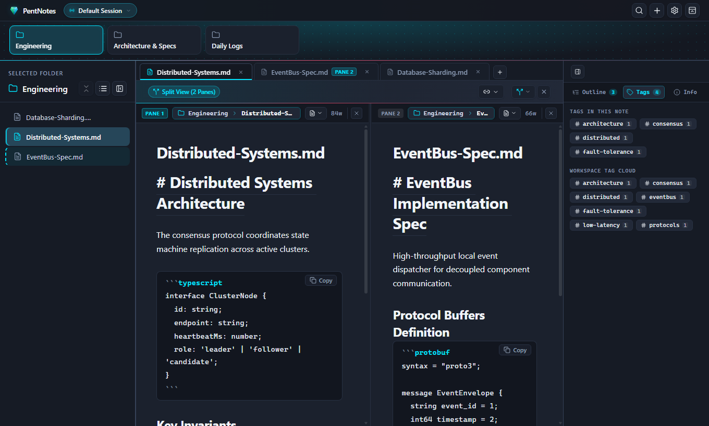
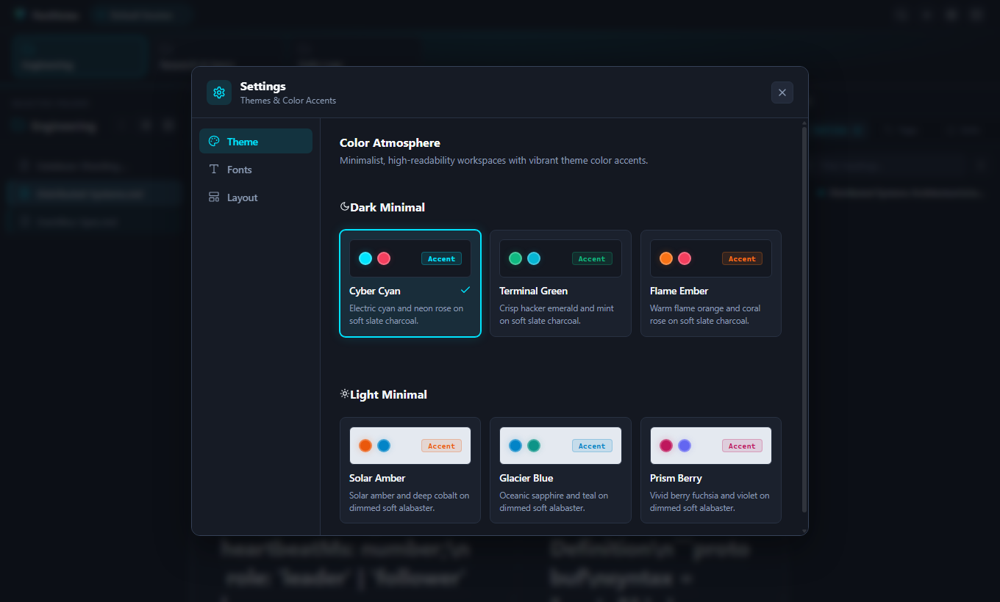

<div align="center">



# PentNotes

**A high-performance, local-first Markdown workspace with infinite split panes, side-by-side PDF reading, and an integrated local Ollama AI assistant.**

[](https://www.electronjs.org/)
[](https://react.dev/)
[](https://www.typescriptlang.org/)
[](https://codemirror.net/)
[](LICENSE)

<br />



</div>

---

## Overview

**PentNotes** is crafted for developers, researchers, and technical writers who want the speed of plain text combined with the power of modern IDE workflows. Your notes remain plain `.md` files directly on your disk—giving you zero vendor lock-in, blazing performance, and complete data privacy.

<br />



---

## Key Features

- **⚡ Recursive Split Panes & Grid Layouts**: Split your editor vertically or horizontally into arbitrary grids. Work on multiple notes side-by-side with fluid drag-and-drop resizing and independent tab groups.
- **📝 CodeMirror 6 Markdown Engine**: Live syntax highlighting, inline tag decorations, auto-closing brackets, code blocks with language highlighting, and drag-and-drop image pasting.
- **📄 Native PDF Viewer**: Open technical papers and documentation in a split pane right next to your active note without switching apps.
- **🤖 Built-in Local Ollama AI**: Chat with local LLMs (e.g., Llama 3, DeepSeek, Mistral) directly in the sidebar. Includes note context awareness and web search capability.
- **📂 Local-First Disk Linking**: Link any existing folder on your computer as a workspace. Changes made on disk sync seamlessly into PentNotes.
- **🔗 Knowledge Graph & Note Connections**: Link notes using `[[wikilinks]]` and explore backlinks and related notes in the catalog sidebar.
- **🎨 Minimalist Theming**: Clean dark and light themes (Cyber Cyan, Terminal Green, Flame Ember, Glacier Blue, and Solar Amber) with customizable typography and font scaling.

---

## App Walkthrough & Screenshots

### Multi-Pane Split Editor & Table of Contents
Split your workspace freely across columns and rows with synchronized outline navigation, word counters, and syntax-highlighted code blocks:
<p align="center">
  
</p>

### Instant Global Search (`Ctrl+P` / `Cmd+P`)
Quickly search note titles, file contents, and paths with live snippet previews:
<p align="center">
  
</p>

### Workspace Tag Cloud & Document Metadata
Inspect tags, jump to line references, and analyze reading statistics across all notes in the right sidebar catalog:
<p align="center">
  
</p>

### Theme & Typography Settings
Choose from curated high-contrast dark and light minimal color atmospheres with custom font sizing:
<p align="center">
  
</p>

---

## Installation & Getting Started

### Prerequisites

- **[Node.js](https://nodejs.org/)** (v18.0.0 or later recommended)
- **npm** (comes with Node.js)
- *(Optional)* **[Ollama](https://ollama.com/)** running locally on port 11434 if you want to use the local AI assistant.

### 1. Clone the Repository

```bash
git clone https://github.com/your-username/pent-notes.git
cd pent-notes
```

### 2. Install Dependencies

```bash
npm install
```

### 3. Launch Development Mode

Start the app in Electron development mode with Hot Module Replacement (HMR):

```bash
npm run dev:electron
```

> **Tip:** You can also run the web renderer standalone in your browser using `npm run dev`.

### 4. Build for Production

Compile TypeScript and bundle the Electron main, preload, and renderer packages:

```bash
npm run build:electron
```

To run a preview of the production build:

```bash
npm run preview:electron
```

---

## Usage Guide

### Linking a Folder on Disk
1. Click the **+** button in the top navigation bar or select **Link Folder to Disk**.
2. Choose any local directory containing your `.md` notes or documents.
3. PentNotes instantly indexes the directory into the tree explorer without copying or modifying your files.

### Working with Split Panes
- Click the **Split** menu button in any pane header to split **Vertically**, **Horizontally**, or into a **2x2 Grid**.
- Drag tab headers between panes to reorganize your workspace.
- Drag the divider handles between panes to fine-tune your screen space.

### Using the Ollama Local AI Assistant
1. Ensure Ollama is running (`ollama serve`).
2. Switch to the **Chat** tab in the right sidebar.
3. Select an installed model from the dropdown (or type a new model name like `llama3.2` to pull it).
4. Toggle **Context** to inject your active note into the conversation, or toggle **Web Search** for live queries.

---

## Keyboard Shortcuts

| Shortcut | Action |
| :--- | :--- |
| `Ctrl+P` / `Cmd+P` | Open Global Search modal |
| `Ctrl+N` / `Cmd+N` | Create a new note |
| `Ctrl+\` / `Cmd+\` | Split active pane vertically |
| `Ctrl+B` / `Cmd+B` | Toggle left folder explorer sidebar |
| `Ctrl+,` / `Cmd+,` | Open Preferences & Theme Settings |
| `Esc` | Close active modal dialog |

---

## Architecture

The codebase follows a modular, clean Staff-engineer architecture:

```text
src/
├── components/          # Reusable domain components
│   ├── editor/          # CodeMirror Markdown editor & PDF viewer
│   ├── modals/          # Link Folder, Search, Session, Settings
│   ├── navbar/          # Top navigation bar & tabs
│   ├── panes/           # Recursive pane layout tree & tab management
│   └── sidebar/         # Folder tree explorer & note catalog / AI chat
├── hooks/               # DOM, shortcut, and UI interaction hooks
├── lib/                 # Core utilities (file system API, catalog, tree)
├── main/                # Electron main process & IPC handlers
├── preload/             # Secure contextBridge preload scripts
├── store/               # Centralized Zustand application state
└── styles/              # Design tokens and theme system
```

---

## License

This project is licensed under the MIT License - see the [LICENSE](LICENSE) file for details.
